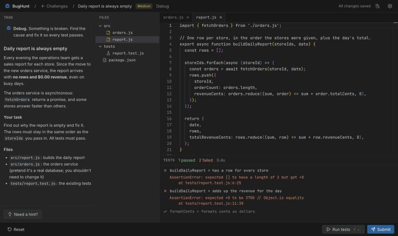

# DevDrill

> **In the era of AI, practice the skills you actually need.**

AI writes a lot of code now. What's left for you, and what interviews increasingly test, is **working with code you didn't write**: finding why it's broken, changing it without breaking what already works, and reviewing someone else's change before it merges.

DevDrill gives you small, realistic projects to practice exactly that, in **JavaScript or TypeScript**, in a VS Code-style editor in your browser. Everything runs on your own machine.

```bash
npx devdrill
```



Requires [Node.js](https://nodejs.org) 22 (22.12+), 24, or 26 and newer.

## How it works

There are three kinds of challenges:

- **Debug**: something is broken. Read the code, find the cause, fix it.
- **Feature**: add a feature to working code. The existing tests pass at the start and must keep passing.
- **Review**: read a pull request, comment on what's wrong, and decide: approve or request changes.

A debug or feature challenge has a short task description, a few files, and tests.

1. **Run tests** (`⌘/Ctrl + Enter`) runs the visible tests, as often as you like.
2. **Submit** (`⌘/Ctrl + Shift + Enter`) also runs **hidden tests** that check the edge cases. Fixing only the symptom the visible tests show usually isn't enough.
3. **Results** tell you what passed and failed. Hidden tests show only their names until you solve the challenge. After solving, you can compare your code with the reference solution.

Hints come one at a time, from "where to look" to "almost the answer". A timer runs while you work, like in a timed interview; you can turn it off in Settings.

**Review challenges** show the pull request's description and its diff. Hover a line in the new code and click **+** (or select several lines, or a whole function) to leave a comment in your own words. Then approve the pull request or request changes, and submit.

- **Passing is the verdict:** request changes when something must change before merging, approve when nothing does. Some pull requests are fine as they are.
- **Then you grade yourself:** the answer key appears next to your review, with your comments under each issue they're on. Tick the issues you really caught; your score is the share you ticked, and must-fix issues count most (must 3, should 2, nit 1).
- Without AI there's no fair way to judge free-text comments automatically, so DevDrill doesn't pretend to. Your results, ticks and best score are saved, so you can come back to them.

**AI (optional):** connect an AI provider in Settings and DevDrill can:

- **judge your review:** read your comments against the answer key and say, per issue, caught / partly / missed (it pre-ticks; every tick stays yours);
- **give feedback on your code** after you solve a challenge: risks the tests miss, readability, a simpler way;
- **give a hint** when you're stuck: a nudge, never the answer (it never sees the solution).

Pick **Claude**, **OpenAI**, **Ollama** (local models: free, offline, nothing leaves your machine), **OpenCode** (your local OpenCode server and whatever it's connected to), or **Custom** (any OpenAI-compatible API: DeepSeek, OpenRouter, LM Studio…). Keys are saved in `~/.devdrill/ai.json`, readable only by you, and never sent to the browser. The AI gives feedback; it never decides pass or fail. Without a provider, nothing changes.

**Languages:** every challenge comes in JavaScript and TypeScript. Pick one on the challenge list, in Settings, or inside a challenge. Your code and progress are kept separately per language. In TypeScript, type errors are underlined like in VS Code, but they don't stop the tests from running.

**Honor system:** the hidden tests and solutions ship with the app, and you can read them if you go looking. It's practice; the only person you'd be fooling is yourself.

## Challenges

| Mode    | Challenge                       | Difficulty |
| ------- | ------------------------------- | ---------- |
| Debug   | Cart total ignores discount     | Easy       |
| Debug   | Pagination skips an item        | Easy       |
| Debug   | Leaderboard sorts wrong         | Medium     |
| Debug   | Daily report is always empty    | Medium     |
| Debug   | Settings leak between users     | Medium     |
| Feature | Add search to the todo list     | Easy       |
| Feature | Rate limit each user separately | Medium     |
| Feature | Hold stock during checkout      | Medium     |
| Review  | Coupons and free shipping       | Easy       |
| Review  | Account settings endpoints      | Medium     |
| Review  | "Last seen" times               | Medium     |

New challenges are very welcome: see [CONTRIBUTING.md](CONTRIBUTING.md).

## Options

```
npx devdrill --port 4000   # use a specific port (default 3000, or a free one)
npx devdrill --no-open     # don't open a browser; just print the link
npx devdrill --help
```

## Your data and safety

- Your code, progress and settings live in `~/.devdrill`. Settings → "Reset all progress" starts over.
- The server listens on `127.0.0.1` only. Because your code runs on your machine, the API is locked down so other websites can't reach it: it checks the Host and Origin headers, requires JSON, and needs a secret token. That's why the app opens with a link ending in `#token=…`.
- Your tests run with the app's own Vitest; challenges have no dependencies and nothing is installed per challenge.

## Development

Developing needs Node 22.13+ (for ESLint), 24, or 26+.

```bash
npm install
npm run dev        # API server + Vite with hot reload; open the "Dev UI" link it prints
npm run check      # lint, format check, typecheck, tests, and challenge validation
npm run validate   # only validate challenges
npm run build:release && npm pack ./release   # build and pack the publishable package
```

The repo is an npm workspace:

- `packages/server`: the Express API, test runner and workspace manager
- `packages/web`: the React + Vite UI (Monaco editor, Tailwind)
- `packages/shared`: TypeScript types shared by both
- `challenges/`: the challenges
- `scripts/`: challenge validation, dev runner, release build
- `docs/V1_PLAN.md`: the plan and the decisions behind it

## License

[MIT](LICENSE)
